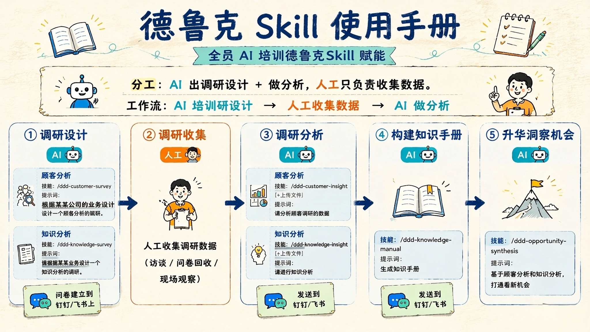

# 德鲁克工作坊 · 技能包（DruckerSkill）

将彼得·德鲁克（Peter Drucker）的管理方法论，沉淀为一组可在 WorkBuddy 中直接调用的 AI 技能，配套一个结构化知识库 **DruckerWiki**。适用于企业开展德鲁克工作坊：从顾客调研、知识洞察，到机会推演，形成完整闭环。

---

## 📖 技能使用手册

安装前请先浏览使用手册，每个技能的调用提示词都在图中：



---

## 📦 包含内容

### 8 个 `ddd-` 系列技能（位于 `skills/`）

| 技能 | 作用 |
|------|------|
| `ddd-customer-survey` | 顾客调研设计：输出调研方案、问卷、访谈提纲与分析 schema |
| `ddd-customer-insight` | 顾客洞察分析：升维为顾客分析画布与洞察报告（含原话溯源） |
| `ddd-customer-knowledge-scan` | 现状感知扫描：对话式问卷，答完提交大屏实时汇总 |
| `ddd-knowledge-survey` | 知识分析调研设计：输出 A/B/C 探询提纲与知识画布框架 |
| `ddd-knowledge-insight` | 知识洞察分析：提炼独特知识，输出洞察报告与机器可读 bundle |
| `ddd-knowledge-manual` | 知识手册维护：带版本、时间戳、半年提醒的「活」手册 |
| `ddd-knowledge-qa` | 德鲁克知识问答：基于知识库逐字引用原话作答 |
| `ddd-opportunity-synthesis` | 机会综合：交汇顾客与知识洞察，套 7 大创新源推演新机会 |

### 1 个知识库（位于 `DruckerWiki/`）

德鲁克四本核心著作的结构化知识库（339 个知识点 + 14 个跨书概念），是 `ddd-knowledge-qa` 等技能的检索源。安装时需复制到用户主目录，最终路径为 `~/DruckerWiki`。

---

## 🚀 安装

**安装请严格按照仓库根目录下的 [`install.md`](install.md)（安装说明）执行。**

要点速览：

1. 将 `skills/` 下的全部技能安装到当前智能体，安装为**用户级 SKILL**；
2. 将 `DruckerWiki/` 复制到主目录，形成 `~/DruckerWiki`；
3. 安装完毕后，按 `install.md` 的约定把「技能使用手册」图片发送给使用者。

详细步骤、验证方法与注意事项均以 `install.md` 为准。

---

## 🧭 推荐工作流

技能分两条主线 + 一个交汇点：

```
【顾客线】  ddd-customer-survey  →  ddd-customer-insight
【知识线】  ddd-knowledge-survey →  ddd-knowledge-insight → ddd-knowledge-manual
【交汇】    两条线的 bundle → ddd-opportunity-synthesis（推演新机会/新能力）
【随时用】  ddd-knowledge-qa、ddd-customer-knowledge-scan
```

具体提示词见上方「技能使用手册」图片。

---

## ❓ 支持

安装或使用中如有问题，请联系工作坊组织者。

作者：罗飞　微信：jianyueluofei
